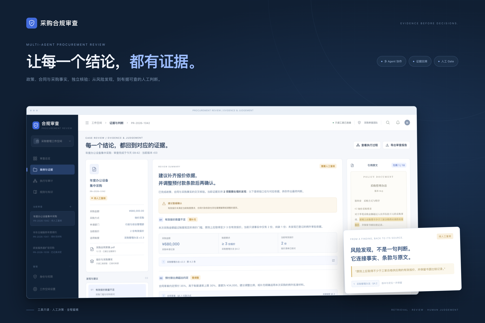
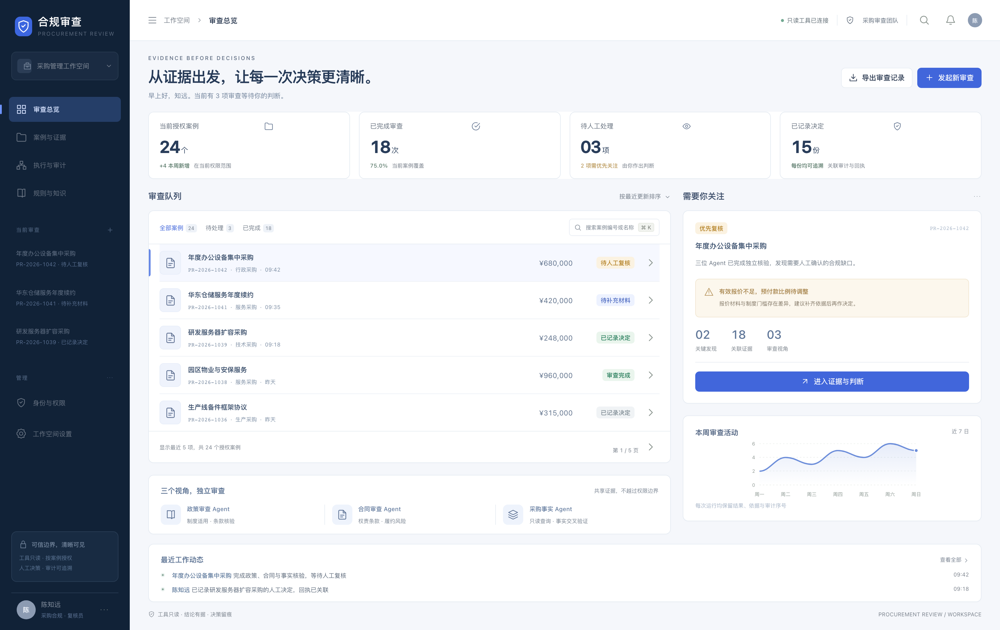
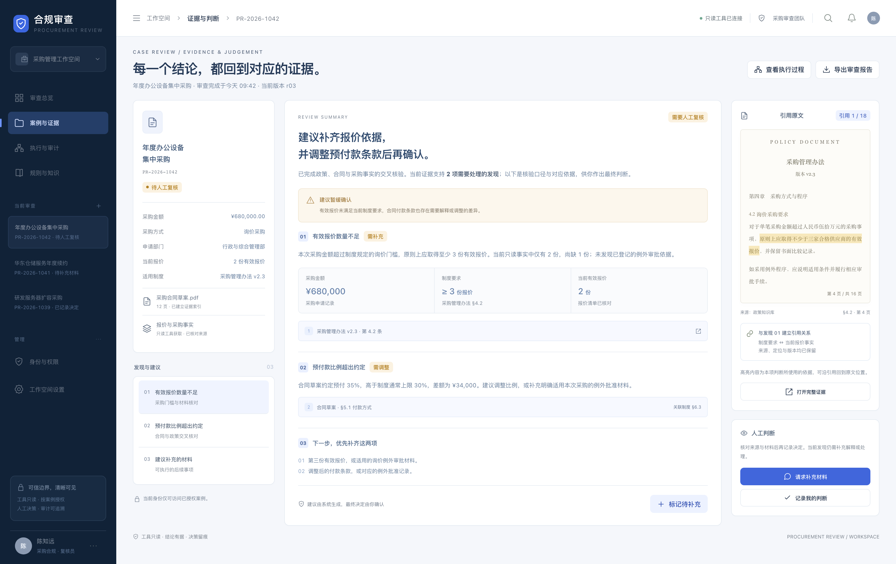
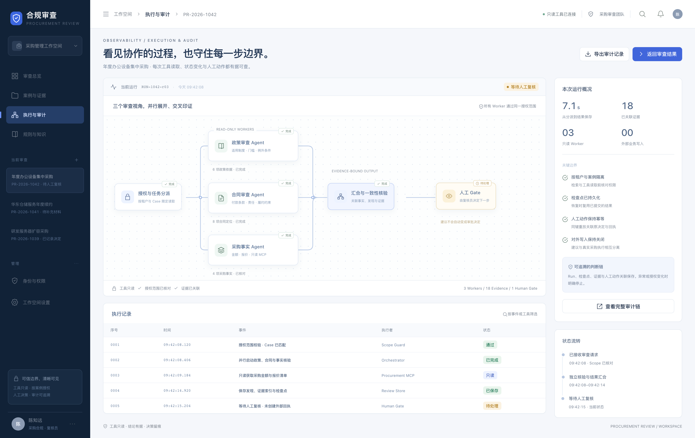

# 采购合规审查 · 产品界面

深蓝导航与克制的风险色，强调政策、合同、采购事实之间的核对关系，以及证据到人工判断的连续路径。

以下为产品设计预览，使用演示数据呈现目标体验；当前实现范围以[项目说明](../../README.md)与代码为准。图片内专注展示产品界面。



## 审查总览

在一个工作台中查看授权案例、审查队列、待处理发现与近期动态；三个审查视角清晰分工。



## 证据与判断

左侧保留案例与发现，中间呈现事实、条款和下一步，右侧直接定位高亮原文与人工处理入口。



## 执行与审计

通过并行流程图展示三位 Worker 的独立核验、结果汇合与人工 Gate，并关联逐条执行记录、检查点和授权边界。



## 本地查看与导出

直接用浏览器打开 [index.html](index.html)，可通过左侧导航切换三个场景。全部样式、图标和展示内容均保存在本目录，不请求后端或外部模型。

界面图为 **3360 × 2120 PNG**，封面为 **3840 × 2560 PNG**。字体使用操作系统提供的中文与西文字体；图标、图表与标志由本地 SVG/CSS 绘制，没有引入外部图片或远程字体。

重新导出需本机安装 Node.js 与 Playwright/Chromium，在本目录执行：

```bash
node render.mjs --review --cover
```

如果 Playwright 不在当前模块搜索路径，可通过 `PLAYWRIGHT_MODULE_PATH` 指向自己的安装位置。`render-checks.json` 记录画布边界与浏览器脚本错误检查。
